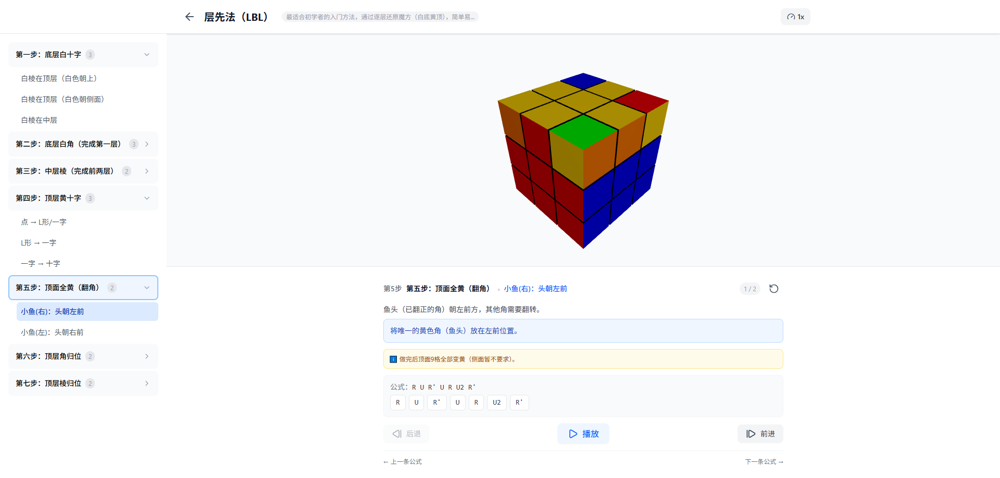

# Magic Cube - 交互式3D魔方教学

[English](./README.md) | [中文](./README_CN.md)

一个基于 WebGL 的交互式魔方学习应用，通过实时 3D 可视化动画，从入门到精通逐步掌握魔方还原技巧。

<p align="center">
  <a href="https://magic-cube-learn.973554752.workers.dev/">🔗 在线演示</a>
</p>

<p align="center">
  
</p>
<p align="center">
  
</p>


## ✨ 特性

- **3D 可视化** — 基于 Three.js 和 React Three Fiber 的实时 WebGL 渲染，支持流畅的转动动画和自由视角旋转
- **多种还原方法** — 三套完整的还原教程，覆盖入门到高级：
  - **层先法** — 最适合初学者的入门方法，逐层还原，简单易学
  - **CFOP** — 最主流的速拧方法（Cross → F2L → OLL → PLL）
  - **桥式（Roux）** — 高效速拧方法，通过构建桥和 LSE 完成还原，步数更少
- **分步教学** — 每条公式包含：
  - 精确的初始魔方状态（通过逆算法自动生成），确保演示准确
  - 动画播放，逐步高亮当前执行的操作
  - 详细的文字说明和技巧提示
  - 公式搜索功能，快速查找大型步骤组中的公式
- **播放控制** — 播放/暂停、前进/后退、速度调节（0.5x / 1x / 2x）、重播
- **自由练习模式** — 打乱、重置、自由操作，支持快速连点排队执行
- **响应式设计** — 针对桌面端、平板和移动设备全面适配

## 🛠️ 技术栈

| 类别 | 技术 |
|------|------|
| 框架 | React 19 + TypeScript |
| 构建工具 | Vite 8 |
| 3D 引擎 | Three.js + @react-three/fiber + @react-three/drei |
| 样式方案 | Tailwind CSS 4 |
| 动画库 | Framer Motion |
| 状态管理 | Zustand |
| 路由 | Wouter |
| 代码检查 | Oxlint |
| 测试框架 | Vitest |

## 🚀 快速开始

### 环境要求

- Node.js >= 18
- npm >= 9

### 安装

```bash
# 克隆仓库
git clone https://github.com/dgqi/magic-cube-learn-web.git
cd magic-cube

# 安装依赖
npm install

# 启动开发服务器
npm run dev
```

### 构建

```bash
# 生产构建
npm run build

# 预览生产版本
npm run preview
```

### 测试

```bash
# 运行测试
npx vitest
```

## 📖 使用说明

1. **首页** — 浏览可用的还原方法，选择适合你水平的教程
2. **学习模式** — 按步骤组和个人公式导航：
   - 点击侧边栏的步骤组展开内容
   - 选择一条公式，魔方自动切换到对应的初始状态
   - 点击 **播放** 观看动画演示
   - 使用 **前进/后退** 按钮逐步查看每一步操作
   - 通过速度控制器调节动画速度
3. **自由练习** — 自由探索和练习：
   - 点击 **打乱** 随机打乱魔方
   - 使用操作按钮（U、U'、U2、D、D' 等）执行转动
   - 支持快速连点，操作自动排队依次执行
   - 鼠标拖拽旋转 3D 视角

## 🧩 项目架构

```
src/
├── components/cube/    # 3D 魔方渲染组件
│   ├── Cube3D.tsx      # 核心 3D 魔方模型
│   ├── CubeScene.tsx   # 场景包装器（相机 & 控制器）
│   └── Cubie.tsx       # 单个小方块及面颜色
├── engine/             # 魔方逻辑引擎
│   ├── cube.ts         # 状态管理 & 操作执行
│   ├── moveSpec.ts     # 操作规格定义
│   ├── normalize.ts    # 操作符号归一化
│   └── setupBuilder.ts # 基于逆算法的初始状态生成
├── methods/            # 还原方法定义
│   ├── layerByLayer.ts # 层先法（入门）
│   ├── cfop.ts         # CFOP（进阶）
│   └── roux.ts         # 桥式（高级）
├── pages/              # 应用页面
│   ├── HomePage.tsx    # 首页（方法选择）
│   ├── LearnPage.tsx   # 交互式教学页面
│   └── PlayPage.tsx    # 自由练习模式
├── store/              # 全局状态（Zustand）
└── types/              # TypeScript 类型定义
```

## 🎨 配色方案

魔方采用标准 WCA 配色，**黄色为顶面（UP）**，**白色为底面（DOWN）**：

| 面 | 颜色 |
|----|------|
| 上 (U) | 黄色 |
| 下 (D) | 白色 |
| 前 (F) | 绿色 |
| 后 (B) | 蓝色 |
| 右 (R) | 红色 |
| 左 (L) | 橙色 |

## 🤝 贡献

欢迎参与贡献！你可以：

- 通过 [Issues](https://github.com/your-username/magic-cube/issues) 反馈 Bug
- 提交 Pull Request 添加新功能或修复问题
- 添加新的还原方法或公式
- 改进翻译

### 开发规范

- 遵循现有的 TypeScript 类型定义和命名约定
- 所有新公式必须包含正确的 `setupState`（通过逆算法生成）
- 提交前运行 `npx vitest` 确保所有测试通过
- 确保响应式设计在各尺寸屏幕上正常工作

## 📄 开源协议

本项目基于 [MIT 协议](LICENSE) 开源。

## 🙏 致谢

- 魔方还原方法参考速拧社区公认资源
- 使用 [React Three Fiber](https://github.com/pmndrs/react-three-fiber) 进行声明式 3D 开发
- 图标来自 [Lucide](https://lucide.dev/)

---

<p align="center">
  <b>Magic Cube</b> — 让魔方还原变得简单有趣 🧊
</p>
